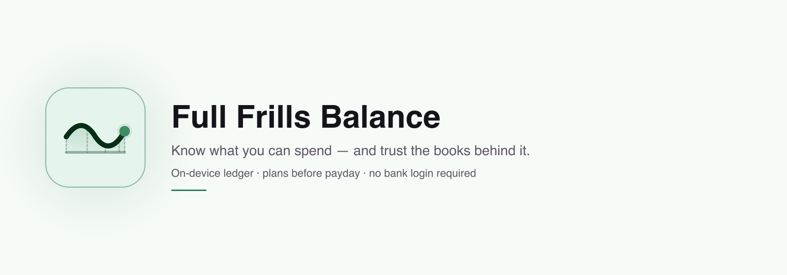

<p align="center">
  <picture>
    <source media="(prefers-color-scheme: dark)" srcset="assets/readme/header-dark.png" />
    <source media="(prefers-color-scheme: light)" srcset="assets/readme/header-light.png" />
    
  </picture>
</p>

<p align="center">
  <a href="https://github.com/SahilSoniOrg/full-frills-balance/actions/workflows/ci.yml"></a>
  
  
  
  
</p>

# Full Frills Balance

A personal finance app for people who want to **know what they can spend**, keep books that actually balance, and leave their ledger on their own device — no bank login required for ordinary use.

| | |
|---|---|
| **Landing & get the app** | [fullfrills.sahilsoni.in](https://fullfrills.sahilsoni.in) |
| **Web app (ready to use)** | [fullfrillsapp.sahilsoni.in](https://fullfrillsapp.sahilsoni.in) |

---

## Who it’s for

People who want personal or household finances that **actually add up** — without linking a bank, signing up for a cloud account, or trusting a balance the app invented.

If you’ve ever wondered “can I afford this before payday?” or “where did that money go?” and wanted a clear ledger instead of another spend-tracker, this is aimed at you.

---

## What you get out of it

| Need | How the app helps |
|------|-------------------|
| **Know what’s true** | Double-entry journals that won’t save unbalanced. Account balances come from transactions, not a number you typed in. |
| **See the whole picture** | Net worth, recent activity, income vs spending, and category reports — across accounts and currencies. |
| **Plan before you spend** | Budgets and planned payments (recurring or one-off). **Safe to Spend** estimates how much you can use today without going broke before payday. |
| **Keep separate books** | Workplaces let you keep personal, household, or side projects apart. |
| **Capture without chaos** | Optional Android SMS and Gmail capture suggest or post transactions; uncertain matches stay for review. |
| **Stay in control** | Data lives on your device. Export/restore JSON, import Ivy Wallet or Cashew, biometric lock, privacy mask, widgets, voice draft. |

Full Frills Balance is a **record-keeping tool**. Safe to Spend is an estimate from the entries and plans you provide — not financial, tax, or investment advice.

---

## Day to day

1. **Record** income, spending, transfers, or multi-line journals with notes and categories.
2. **Organize** assets, liabilities, equity, income, and expense accounts (with hierarchy and per-account currency).
3. **Glance** at the dashboard: net worth, feed, privacy mask, Safe to Spend.
4. **Look ahead** on Plans: budgets and upcoming obligations.
5. **Review** reports when you want the longer story.

Four tabs: **Dashboard · Accounts · Plans · Transactions**. Add actions follow the current tab; workplaces and Settings live in the drawer.

**Try sample data without touching yours:** Settings → Data Management → **Setup Demo Workplace**.

---

## Safe to Spend

> How much can you spend today without going broke before payday?

Not your bank balance — what’s left after bills, budgets, and liabilities over the next ~30 days.

```text
  Liquid assets now
+ Upcoming income (planned)
− Committed spending (budgets, bills, planned payments)
− Near-term debt / liability payments
────────────────────────────────────────
= Safe to Spend
```

The app walks the cash-flow day by day, merges overlapping obligations, normalizes currencies, and uses the **lowest** projected liquid balance in that window.

---

## Privacy (for users)

- Ordinary bookkeeping needs **no bank connection** and **no app account**.
- Financial data stays on your device.
- Optional SMS / Gmail capture runs locally; you review uncertain matches.
- Analytics are coarse event counts — not amounts, merchants, or balances. Session replay is off.

Details: [PRIVACY.MD](PRIVACY.MD) · [Privacy policy](https://fullfrills.sahilsoni.in/privacy.html)

---

## Quick start (developers)

**Prerequisites:** Node 22+ ([`.nvmrc`](.nvmrc)), Bun ([`.bun-version`](.bun-version)), Xcode and/or Android Studio. Native modules need a **dev client** (not Expo Go).

```bash
bun install
cp .env.example .env.local   # optional — app runs without secrets
bun run ios                  # or: bun run android
```

| Command | Purpose |
|---------|---------|
| `bun run ios` / `android` | Native development |
| `bun run android:preview` | Preview variant |
| `bun run android:release` | Production variant on a device (not a store build) |
| `bun run android:publish` | Build and upload to Google Play. See [docs/operations/mobile-release.md](docs/operations/mobile-release.md) |
| `npx expo start --web` | Web (limited; mobile is primary) |
| `bun run verify` | CI gate: architecture + typecheck + tests + lint |

Optional env (analytics, Gmail OAuth): [`.env.example`](.env.example). Architecture map: [docs/architecture/REPOSITORY_MAP.md](docs/architecture/REPOSITORY_MAP.md). Mobile E2E: [docs/architecture/MOBILE_E2E.md](docs/architecture/MOBILE_E2E.md). Domain language: [CONTEXT.md](CONTEXT.md).

```bash
# Web E2E
bun run e2e:setup:web && bun run e2e:build:web && bun run e2e:test:web
```

---

## Tech stack

| Layer | Choice |
|-------|--------|
| App | Expo SDK 58, React Native 0.88, React 19, TypeScript 6 |
| Navigation | Expo Router |
| Data | WatermelonDB → SQLite (native) / LokiJS (web & tests) |
| Quality | Jest, Detox, Playwright (web), ESLint, `bun run verify` |
| Ship | EAS Build (development / preview / production) |

---

## License

Private — not open source.
