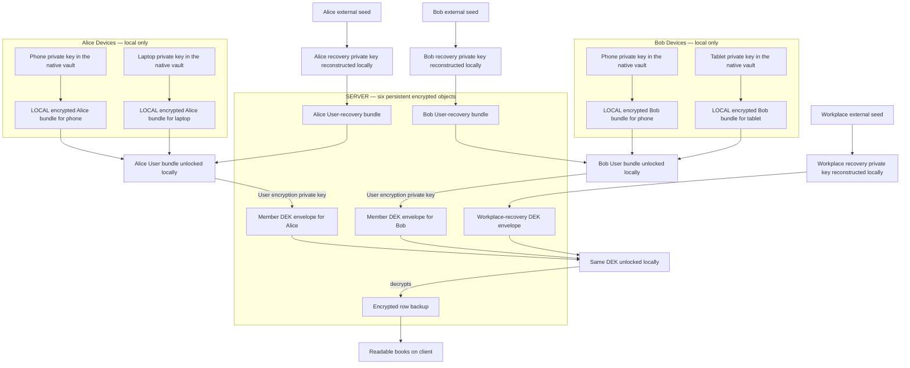

# Key management — one architecture, staged release

Date: 12 October 2026; clarified 13 October 2026.

Status: **key hierarchy APIs implemented on this branch; row-envelope backup/sync in progress per [row-envelope sync](./row-envelope-sync.md); physical-device, interruption and online authorization gates remain open.**

This is one Device → User → Workplace architecture. There is no second key-management design or migration target. Payload wire formats are versioned separately ([row-envelope sync](./row-envelope-sync.md)).

**Confirmed key scope:** one DEK per Workplace, generated deliberately during Workplace creation or upgrade. Persist only encrypted DEK envelopes, never the readable DEK, including in the native vault. Independent User and Device encryption pairs form the unlock chain. An independent User Ed25519 signing pair is created in the initial bundle and retained through User recovery; online signing protocols remain deferred. Only the Device private key persists in the native platform vault, under the same device-only storage policy. The existing app-lock policy applies without per-operation OS authentication. User recovery restores the same User onto a new Device. Workplace emergency material decrypts salvage ciphertext only; it does not restore old tenancy or authority. Users create/export/verify both recovery credentials through the implemented Settings → Data → Encrypted backup setup. The hosted dump API, support workflow, rotation, writer handover, and online identity provider are not implemented.

| Stage                         | Contents                                                                                                                                                                                                                           | Release gate                                                                                                                                                                |
| ----------------------------- | ---------------------------------------------------------------------------------------------------------------------------------------------------------------------------------------------------------------------------------- | --------------------------------------------------------------------------------------------------------------------------------------------------------------------------- |
| Local keys and credentials    | User encryption/signing pairs, Device encryption pair, versioned full User identity pin, local bundles, member/recovery DEK envelopes, both recovery credentials, native credential file pickers. Replacement is recovery-only; no pairing/QR API. | Physical-device and cross-platform HPKE/storage interoperability; app-lock/background behavior; offline backup/restore per [row-envelope sync](./row-envelope-sync.md#rollout-task-list). |
| Online manual backup          | Bind the existing local User UUID explicitly to a login account; registered-Device checks, upload consent, public metadata/envelopes and opaque row backups.                                                                       | Backend authorization and signatures; authenticated manifest/checkpoint chain; key-envelope delivery; retention; schema evolution. No deployed backend exists. |
| Synchronization and sharing   | Multiple writers, manifest-serialised commits, group conflicts, invitations/roles, and member removal. Reuse the same hierarchy.                                                                                                  | [Row-envelope sync](./row-envelope-sync.md) merge gate; invitations; future rotation/removal protocol.                                                                   |

The first deliverable on this branch is the key substrate plus row backup/sync. Cloud enrollment remains unavailable. Offline use assigns a stable local User identity; online login later binds it explicitly to the account. Login must never silently replace an existing identity.

Related: [documentation guide](./README.md), [overview](./spec.md), [row-envelope sync](./row-envelope-sync.md), [implementation scope](./preparation.md), [verification and remaining gates](./preparation.md#verification-and-remaining-gates).

## 1. Decisions and terminology

The agreed chain is:

```text
Device private encryption key — persisted in this Device's native vault
    opens this Device's encrypted copy of the User private-key bundle
        User private encryption key opens the User's Workplace DEK envelopes
            Workplace DEK decrypts the financial payload
```

- Generate User keys, Device keys, and Workplace DEKs independently using secure randomness. No BIP-32 or application-level HKDF tree derives Device keys from a User root.
- A Device protects a copy of the User key material, not a separate copy of each Workplace DEK.
- A User has the same membership rights across approved Devices. Workplace selection controls what a Device downloads, not a cryptographic restriction on that Device's User key.
- Keep one DEK per Workplace; future rotation may introduce generations. Multiple members receive separate encrypted envelopes of that same DEK; financial ciphertext is not duplicated per member or Device.
- Two separate routes exist: **User recovery** restores the same User onto a new Device; **Workplace emergency export** decrypts a salvage dump to import into a new Workplace. The latter does not recover old User/owner authority.
- Device-encrypted User bundles live locally only. Other ciphertext may live locally or remotely under its retention/access rules. Device private keys are opened only inside the native crypto module. Future QR transfer would use a transient ciphertext relay, not a persistent server Device bundle; local pairing and QR are not implemented. The backend receives no readable decryption secrets.
- Bind User keys/envelopes to a stable application User UUID, not an email address. Email is a changeable login/contact attribute; future provider subjects map explicitly to this UUID. Supabase Auth is the current Phase 2 direction, confirmed 13 October; no auth integration or backend project exists yet.
- Email/login credentials prove account access; they do not automatically decrypt books or approve a new Device by themselves.

**Concrete representation for this document:** use independent public/private encryption key pairs at the User and Device layers. “User KEK” and “Device KEK” describe their wrapping roles, not two additional symmetric secrets. A recipient's public key creates an envelope; its private key opens it. This makes invitations possible without revealing the recipient's private key. The local implementation uses HPKE base mode with DHKEM(X25519, HKDF-SHA256), HKDF-SHA256 and AES-256-GCM through OpenSSL’s native HPKE API. Tests exercise the shared native implementation, including an AES known-answer vector; signing fixtures use Node’s built-in crypto. No JavaScript HPKE implementation is used. User and Device pairs are generated independently. Recovery pairs are reconstructed solely from their own independent 256-bit seeds through OpenSSL `OSSL_HPKE_keygen` with the recovery seed supplied as RFC 9180 input key material. HPKE’s internal KDF does not derive a Device from a User root.

Signing is separate from encryption. Setup generates an independent **Ed25519 User signing pair now**, inside the shared native OpenSSL crypto module. Both private keys are included in the Device-encrypted and User-recovery bundles (X25519 private bytes and Ed25519 PKCS#8 encoding). The full public identity is a versioned record containing format, User UUID, encryption algorithm/public key and signing algorithm/public key. The credential's `identityKeyId` is SHA-256 over a canonical fixed-order serialization of that entire record; it is not a hash of just the encryption key. Recovery verifies this pin and possession of both private keys. HPKE's recipient key ID remains the hash of the encryption public key, a separate routing value.

Online enrollment signatures, owner grants, signed row-manifest chains and Device request-signing remain protocol work ([row-envelope sync](./row-envelope-sync.md)). Offline backup integrity uses signed manifests and Merkle roots as defined in [row-envelope sync](./row-envelope-sync.md). User recovery still verifies the independently saved User identity pin and possession of both User private keys before installing keys or publishing books. Creating the initial User signing pair closes the known need to change User credentials when online signing is enabled. Later rollout consumes the same User UUID, keys, credential pin and Workplace DEK; there is no planned root/key-hierarchy migration. Device request-signing keys are installation credentials; provisioning them later does not replace the User root or Workplace DEK.

## 2. Threat model and actual guarantees

Assume a trusted installed client and correct cryptographic primitives. Signed registrations/grants referenced below are future online release requirements, not functionality already supplied by the local encryption APIs. A compromised application/OS can read secrets and plaintext while in use. The service controls availability and server-side authorization; cryptography cannot force a malicious server to enforce permissions.

| Adversary or failure                           | Exposure                                                                     | Protection and limit                                                                                                                                                                                                                                                    |
| ---------------------------------------------- | ---------------------------------------------------------------------------- | ----------------------------------------------------------------------------------------------------------------------------------------------------------------------------------------------------------------------------------------------------------------------- |
| Curious operator or stolen cloud storage       | Ciphertext, public keys, routing IDs, sizes, timing, and recovery envelopes. | Client-held private keys/DEKs and externally held recovery secrets protect financial contents. Metadata remains visible and is disclosed; consented aggregate use follows [row-envelope sync](./row-envelope-sync.md#header-metadata-and-analytics).                    |
| Malicious storage/API                          | Substituted keys, forged grants, replayed or withheld objects.               | Verified recipient identities, signed registrations/grants, and context-bound envelopes resist substitution/forgery. Known authenticated checkpoints detect some rollback. Availability and freshness after total Device loss are not guaranteed.                       |
| Malicious server serving a fake key generation | Invented generation/recipient envelopes or an old signed head.               | Members accept only owner-signed grants under the pinned identity, with predecessor/hash checks; a fabricated grant fails. Old valid grants still require a trusted checkpoint to detect withholding/rollback. A compromised owner signing key defeats this protection. |
| Lost Device with removal/revoke only           | Previously copied User root, DEKs, and plaintext.                            | Removing server access does not recover confidentiality. User-root replacement is deferred; do not claim current recovery/removal excludes a thief holding that root from future member envelopes.                                                                      |
| Email/session takeover                         | Account-authenticated API access.                                            | Cannot decrypt or enroll a trusted Device without a valid key route and enrollment authority. Destructive account operations require defined Device checks; a malicious server can still delete data.                                                                   |
| Locked stolen Device                           | App files and persisted encrypted bundles.                                   | The native vault and configured app-lock policy protect Device keys. iOS uses when-unlocked Keychain; Android uses a non-exportable Keystore wrapping key. The Device X25519 key itself is opened in native memory; fresh OS authentication is not required.            |
| Compromised approved/unlocked Device           | Device secrets, recoverable User bundle, DEKs, plaintext.                    | No confidentiality guarantee for accessible Workplaces. Future signed enrollment may additionally give the bundle enrollment authority. This is an accepted consequence of the shared User-root model.                                                                  |
| Compromised User private-key bundle            | User encryption and signing authority.                                       | Accessible Workplace envelopes and new-device approval are exposed. Independent Device secrets cannot be calculated from the root, but the root already exposes the books.                                                                                              |
| Stolen Workplace recovery secret plus dump     | That Workplace's DEK and encrypted data for the covered generations.         | No confidentiality guarantee for those generations; no User identity or online write credentials are supplied by this route.                                                                                                                                            |
| Stolen User recovery secret plus bundle        | Same User encryption and enrollment authority.                               | Potential access to all that User's Workplaces. Removing Device access cannot invalidate these keys; identity replacement is deferred.                                                                                                                                  |
| Loss of all Devices and recovery routes        | Email account and ciphertext only.                                           | Data is unrecoverable; no server escrow or email-only decryption promise.                                                                                                                                                                                               |

The Device layer protects persisted delivery of the User bundle and separates installation credentials. It does not make an approved Device less privileged than its User, and it does not protect the books after User-key compromise.

## 3. Keys and storage

The independently usable recovery credential is the **generated, downloadable User recovery phrase**, saved outside the Devices; it is not a system/WebAuthn passkey. Recovery seed/pair entries below use the implemented HPKE suite; online authorization remains proposed. The implemented credential uses eight hexadecimal seed groups plus a 48-bit checksum, bound to purpose, identity, identity key and recovery recipient; User-key replacement is outside the current scope.

| Object                           | Generation and purpose                                                                                                                                                                          | Persistent location                                                                                                                                   |
| -------------------------------- | ----------------------------------------------------------------------------------------------------------------------------------------------------------------------------------------------- | ----------------------------------------------------------------------------------------------------------------------------------------------------- |
| Workplace DEK                    | Random 256-bit symmetric key created once per Workplace; encrypts financial payloads.                                                                                                     | Member and Workplace-recovery envelopes only. Readable bytes exist in memory during use, never in the native vault, caches, preferences or app files. |
| User encryption pair             | Independent library-generated pair; recipient for member DEK envelopes.                                                                                                                         | Verified public identity; private key inside local Device-encrypted bundles and the User-recovery bundle.                                             |
| User signing pair                | Independent Ed25519 pair generated at initial setup; online authorization protocol is deferred.                                                                                                 | Private key in both encrypted User bundles; public key in the versioned identity record.                                                              |
| Device encryption pair           | Independently generated per User/installation; opens its local User bundle.                                                                                                                     | Private key in the account-scoped native vault; public key in signed registration.                                                                    |
| Future Device signing pair       | Separate online request-authentication protocol, not yet provisioned.                                                                                                                           | Separate Device-scoped secure storage and verified registration.                                                                                      |
| User recovery seed and pair      | Separate random high-entropy seed reconstructs a recovery encryption pair using the selected library's versioned seed-to-keypair API. Public key encrypts User bundles; private key opens them. | Seed saved externally; public key and its signed binding stored server-side when online. Private key reconstructed only on the recovering client.     |
| Workplace recovery seed and pair | Separate high-entropy seed reconstructs a recovery encryption pair; wraps DEKs without User/signing credentials.                                                                                | Seed saved externally; public key with owner-signed binding stored server-side when online. Private key reconstructed only for dump recovery.         |

Recovery seed reconstruction is intentional and limited to each independent recovery pair. It does not introduce a User-root-to-Device derivation tree. The library suite and credential format are fixed below; native/cross-platform verification remains required before user distribution.

Any client that holds the plaintext bundle/DEK can create a new recovery envelope using its verified recovery **public** key, including for new generations, without entering the seed. Publishing it still requires the appropriate signed User binding or owner grant and current authorization. The backend cannot rewrap an unknown plaintext DEK itself. Pin recovery key IDs/public keys in authenticated identity/generation metadata; never accept an unsigned server replacement.

Device-encrypted User bundles persist **only on their respective Devices**, in local encrypted files outside the Device vault. No persistent server table/object stores these copies. The native platform vault holds the Device private keys that open them. Exclude local Device bundles from app-managed cloud backup/export; any OS file-backup exposure retains its ciphertext nature and is covered by the platform recovery tests. Online persistent storage holds User-recovery bundles, member/recovery DEK envelopes, encrypted payloads, and public/signed metadata.

Normal unlock follows the existing app-lock policy, asks native code to read the account/Device-scoped private key, open the local User bundle, then opens the User-addressed Workplace DEK envelope. Vault operations stay native: iOS uses Keychain with `kSecAttrAccessibleWhenUnlockedThisDeviceOnly`; Android uses its dedicated Keystore wrapping alias and `FFBKeyCrypto` encrypted preferences, excluded from backup/device transfer. The existing app-lock policy supplies authorization; there is no per-operation OS authentication requirement. The current implementation does not claim fresh OS/biometric authentication for each root use; disabling app lock leaves device unlock as the normal key-access boundary while the app is open.

With app lock disabled, the existing shell policy does not revoke native key access merely because the app backgrounds. Android's vault checks device-unlocked state and, on Android 15+, also sets Keystore unlocked-device-required. Older versions use the native unlock check because Android 12–14 have documented key-loss/availability bugs with that flag. There is no per-operation authentication prompt. iOS still applies its when-unlocked Keychain accessibility. The app-lock signal comes from JS and is not an independent defense against a compromised caller.

The key service checks app-lock state before and after awaited key operations. The app shell publishes that policy; an absent shell fails closed. Native code unwraps keys for one operation and clears them afterward; no User-private-key or DEK cache persists. Logout deletes the Device private key and the current local User-bundle reference. Old orphaned ciphertext files may remain until explicit cleanup, but no readable key remains in them. Background encryption has no separate bypass or scheduled uploader on this branch.

Avoid plaintext key files, logs, analytics, clipboard automation, and readable preferences. Best-effort native buffer clearing cannot guarantee erasure of every library/OS copy. Retain required encrypted envelopes durably; losing all usable copies can strand ciphertext. Bind User, Device, Workplace, key ID, generation, purpose, and format, and never cross account namespaces.

The User recovery download carries the generated secret encoded as the recovery phrase, plus User UUID, purpose/encoding version and the trusted fingerprint of the complete versioned User public identity. The encrypted User-recovery bundle is a separate object, retained remotely when online or in a separately retained encrypted package during the local stage. Never mistake the ciphertext package for the secret that opens it; losing both every local package and all remote copies makes the phrase insufficient. The versioned hexadecimal/checksummed credential format must pass native/cross-platform verification before distribution. **Public-key encryption to a recovery recipient does not authenticate the sender:** anyone knowing that public key can construct a replacement ciphertext. Recovery verifies the pinned identity and signed continuity/grants, rather than trusting successful decryption alone. Future identity replacement must explicitly handle updated pins/credentials; it is deferred and not part of current add-a-Device recovery.

### Native module boundary and credential files

The shared `ExpoKeyCrypto` C++ module uses the same OpenSSL provider already bundled by QuickCrypto: HPKE X25519/HKDF-SHA256/AES-256-GCM, Ed25519, row encryption (`encryptRows`/`decryptRows` per [row-envelope sync](./row-envelope-sync.md)), and AES-256-GCM. Native operation results contain public metadata, ciphertext, signatures or readable book data; Device/User private keys and the DEK never cross into JavaScript. JavaScript owns database publication, sync indexes and non-secret checkpoints. Native code checks identities/contexts and the current app-lock policy before returning operation results.

Native tests export and reopen recovery credential files in the documented format, checking metadata and checksums. The JS credential type accepts only native handles, never serialized recovery phrases. Native import verifies a file and retains its contents behind a random process-local handle for at most fifteen minutes; JS sees purpose and identity pins. At most thirty-two handles can exist. Explicit export acquires a lease before the OS picker/share transition, writes the original credential bytes natively and releases the handle afterward. Background/blur cleanup removes unleased handles.

Device vaults use dedicated native storage. Android uses a scoped AndroidKeyStore AES wrapping alias and versioned encrypted records in `FFBKeyCrypto` preferences, excluded from cloud backup and device transfer. iOS uses a dedicated Keychain service with device-only, when-unlocked accessibility. Only the native User-recovery path, after validating the external credential and encrypted User bundle, may initialize a replacement wrapping alias when the old Device key is lost.

This is ordinary native app memory, not a separate process or hardware enclave. Controlled buffers are wiped with OpenSSL’s compiler-resistant clearing; secret-bearing errors are sanitized. Complete erasure and resistance to a compromised app/OS are not guaranteed.

offline backup creation, credential order and restore publication are specified in [row-envelope sync](./row-envelope-sync.md#local-backup-file).

Secret selection and export use native-owned OS document pickers. Android accepts only document-provider content URIs from the native picker. iOS imports through scoped native access and exports via the share sheet without an app-owned plaintext source file. JS receives no secret file URI or contents, only an expiring handle or save result. Disposable proof-file import/export exists only in E2E builds. Ordinary local SQLite and plaintext ZIP import/export retain their existing policy.

### Web platform (WebAssembly rollout)

Implementation plan: [web crypto WASM rollout](../../plans/web-crypto-wasm-rollout-plan.md). **Passkeys, custom domain and account login are Phase 2** — not required for WASM.

- **Same engine:** the shared C++ `Engine` compiles to WebAssembly; wire formats and test vectors match iOS/Android.
- **Worker boundary:** a dedicated Web Worker loads WASM, owns the device vault IndexedDB stores and the non-extractable Web Crypto wrapping key. The main thread adapter sends `{ operation, request }` messages and receives the same JSON results as native `execute()` — references, envelopes, errors — never Device/User private keys or DEK bytes.
- **Public state:** `keyCiphertextStateStore` on web uses a **separate** IndexedDB database from the worker vault; it holds only public metadata and encrypted envelopes, like mobile file records.
- **Device at rest:** the Device private key is stored wrapped (AES-GCM) in the worker vault database; clearing site data removes this Device. Recovery uses the externally saved User recovery file and backup ZIP, as on a lost phone.
- **Weaker than mobile:** (1) any same-origin script (including XSS) can attack the worker/IndexedDB path — there is no Keychain/Keystore barrier from JavaScript; (2) the hosting origin can ship modified WASM unless deploy uses integrity pinning. Both are accepted for self-hosted web in this release.
- **Fail closed:** if WASM fails to load or the worker cannot start, encrypted backup/setup must error clearly — no TypeScript HPKE fallback in production.

Production deploy should use CSP (`'wasm-unsafe-eval'`), `Cross-Origin-Opener-Policy: same-origin` and `Cross-Origin-Embedder-Policy: require-corp` where hosting allows; local `expo start --web` may omit COOP/COEP until production.

### Installation loss and recovery storage

A file locator is only the filename and SHA-256 digest of an immutable encrypted record. It contains no key. These locators live in ordinary app storage (AsyncStorage), not the device-only native vault. They help read local ciphertext; they are never the only recovery locator. Local outbox/consent pointers remain installation-specific and are not recovery artifacts.

The recovery caller loads the independently retained encrypted User-recovery package before passing it to the native key hierarchy. The native proof reads a file retained outside the source installation. Future authorized backend retrieval belongs in the caller; no private key or recovery phrase is sent to it. Workplace envelopes and encrypted backup payloads likewise require independent retention. A phrase plus absent ciphertext cannot recover anything.

For a known User, `describeSetup().user` is `recovery-required` when the local bundle or Device key is missing. Restored app files without device-only keys, or a surviving iOS Keychain key without its app files, never authorize generating a replacement User root. Recover the pinned User encryption/signing keys using the external package and phrase, create a fresh installation Device ID/key, and retain the same DEK/data. Do not adopt or silently delete orphan keys. Corrupt state or temporarily inaccessible storage fails closed; a storage failure is not permission to reset. A public enrollment marker blocks re-enrollment of a locally known User UUID under another Device. After total installation loss, the human/account flow must distinguish existing identity from deliberate creation using the external identity/recovery source; local emptiness cannot prove a new User.

Device-only iOS keys do not migrate to another device through OS backup; iOS Keychain items may survive uninstall. Android app uninstall removes its app-scoped secure storage. The simulator/emulator tests inject these material-loss states and exercise actual vault/file APIs; they do not prove physical iOS migration or uninstall behavior. Those remain release tests. The kill matrix is only partially covered: authenticated readback, write/locator failure, restart and material loss; forced termination at every durable boundary and physical power-loss behavior are open.

## 4. Complete example — two Users, two Devices each

Alice and Bob share one Workplace; each has two approved Devices. In the future sharing/enrollment example, every Device has independent encryption/signing pairs and a local encrypted User bundle. Each User has a separate recovery seed/pair; the Workplace has its own recovery seed/pair. There is one current DEK generation and one encrypted backup state (row envelopes under a signed manifest in the row protocol).

Arrows mean **opens locally**. Recovery public keys create the remote envelopes; seeds/private keys never go to the server.



Signing keys are omitted from the decryption arrows. User signing keys approve Devices and owner grants; Device signing keys authenticate requests. Workplace recovery supplies neither. Server-side recovery public keys and signed bindings are metadata, not additional encrypted payloads.

**Six persistent remote encrypted objects:** 2 User-recovery bundles, 2 member DEK envelopes, 1 Workplace-recovery envelope, 1 encrypted backup (manifest + row envelopes in the row protocol).

## 5. Initial setup and existing Workplace upgrade

Existing local books stay usable without online opt-in. Key enrollment uses the service APIs (`encryptionSetup`, `LocalKeyHierarchy`) described in [§11](#11-current-implementation-and-release-gates); the Settings → Data → Encrypted backup walkthrough calls those services on this branch. Online setup will authenticate/bind the same User identity and publish verified objects; it must not regenerate the hierarchy silently. Preserve Workplace/record IDs, audit history, and financial meaning.

1. Establish or recover the local User identity and explicit per-Workplace encryption intent. In the online stage, authenticate and obtain separate upload consent per Workplace.
2. For a new identity, generate User encryption and Ed25519 signing pairs, pin the versioned public identity, and create the User recovery seed/pair. For an existing identity, recover it; never replace missing keys silently after login.
3. Generate a Device encryption pair, persist its private key in the native vault, and verify readback. Signed Device registration is an online gate.
4. Persist the Device-encrypted User bundle; encrypt the same User bundle to the recovery public key with HPKE context binding the identity pin. Require external save of the recovery credential and verification before treating enrollment as complete.
5. Per Workplace, create or adopt one DEK deliberately, with User-addressed member envelope and Workplace recovery envelope. Verify both saved recovery credentials against their envelopes.
6. Create encrypted backups and sync payloads per [row-envelope sync](./row-envelope-sync.md); verify signed manifests and Merkle roots before trusting backup bytes.
7. Stage ciphertext and metadata durably; reconcile vault, files and database explicitly. Local Device bundles are never uploaded.
8. Online: commit signed manifest chains and envelope sets only after authorization checks; verify server acknowledgement.
9. Retry with the same keys, IDs and bytes; cancellation retains usable books and resumable state.

offline backup ZIP layout, credential order and restore publication are in [row-envelope sync — local backup file](./row-envelope-sync.md#local-backup-file). Ordinary plaintext ZIP export/import remains unchanged.

This path adds identities, envelopes and encrypted row payloads; it does **not** encrypt the SQLite database file in place. Reuse an established Workplace DEK when adding envelopes. Later sharing adds member envelopes; Device enrollment adds a **local** bundle plus transient transfer, not a new remote Device bundle store.

## 6. Add a Device; logout and removal

**Planned pairing/online enrollment, not implemented.** Device replacement on this branch uses User recovery only. This future approval flow must require a fresh OS authentication prompt; the ordinary app-lock policy alone is not enrollment approval. Device signing-key provisioning and signed registration are prerequisites.

1. Authenticate the account online, or select the verified local identity for a future local pairing flow. Generate fresh Device pairs and persist private keys under the existing app-lock/native-vault policy.
2. Create a short-lived request binding User ID, Device ID, both public keys, nonce, expiry, and format. The QR code authenticates the receiving request; it contains no User private key or DEK. Reject key replacement, replay, expiry, and cross-account approval.
3. An approved Device verifies the request, requires fresh OS authentication for enrollment approval, and signs the new Device registration. It encrypts a copy of the User bundle to the receiving Device's public key.
4. Transfer that ciphertext through a **transient relay** (future local transport or bounded server relay). It is not a persistent Device bundle or recovery route. Use a fixed maximum 10-minute lifetime; expiry never registers a different identity automatically.
5. The receiver verifies identity/signatures/context, decrypts, durably saves its local encrypted bundle, verifies authenticated readback, then sends a signed acknowledgement bound to the enrollment and ciphertext hash. Delete relay payload on acknowledgement; expiry/cancellation also deletes it. Exclude payloads from relay logs, durable backup/versioning and recovery exports so the relay cannot become a second persistent bundle store. Keep only a non-secret idempotent receipt. A lost acknowledgement can be resent after restart; an expired incomplete transfer requires approval again with the same verified identity.
6. Complete active registration and fetch authorized memberships/grants. Choose Workplaces to download and open their User-addressed DEK envelopes. Never count a transient transfer as a remotely recoverable Device backup.

Every approved Device is root-capable and passes User encryption/enrollment authority to further approved Devices. Workplace selection does not isolate that root.

Keep three separate actions in Settings:

| Action                             | Behavior and honest UI meaning                                                                                                                                                                                                                                                               |
| ---------------------------------- | -------------------------------------------------------------------------------------------------------------------------------------------------------------------------------------------------------------------------------------------------------------------------------------------- |
| Logout                             | Clear local private keys, encrypted User bundles, cached DEKs, sessions, and in-memory copies. Preserve unrelated financial records under their existing local-storage policy. Does not remove the server Device registration or erase copied plaintext. Re-entry requires pairing/recovery. |
| Remove Device                      | Disable the registration, sessions and outstanding enrollment requests/server access. Do not promise remote erasure or confidentiality recovery. Removal alone does not take back User root keys.                                                                                            |
| Remove and rotate — future feature | Requires User-root replacement plus affected Workplace DEK rotation to exclude copied keys from future payloads. User-root replacement is currently deferred; do not expose this as a working protection or imply removal alone provides it.                                                 |

Use “Remove access” for the current action. Do not offer “Protect future data” as completed until the deferred root-replacement/rotation mechanism exists. Never label removal alone as making copied keys/data safe. Details and interrupted-rotation behavior follow in Section 10.

## 7. Invite another User

Two distinct invitations exist: an **app invitation** asks someone to create a User account; a **Workplace invitation** asks them to accept or reject membership in a particular Workplace. A Workplace invitation received by a non-user first leads through account creation, then returns to that invitation. Creating an account does not itself activate membership.

The registered profile exposes the public keys generated by that User's trusted client. Invitation lookup uses the registered User identity/profile, not an arbitrary public key attached to an email message. A magic link establishes the intended recipient's authenticated account/session; it is neither an encryption key nor a DEK delivery channel. No QR verification is required for User invitations.

**Existing registered User:** the authorized inviter resolves the User's profile keys and prepares a DEK envelope encrypted to that User's public encryption key, with the required signed grant. The invitation is pending until the recipient accepts or rejects. Acceptance atomically activates the authorized membership and releases its envelope/data access; no second manual approval is required. Keep the staged envelope inaccessible to the recipient before activation.

**New User:** the recipient signs up and their client generates/publishes their User public keys. The Workplace invitation records their acceptance, then awaits final approval by the inviting side (the Workplace creator/administrator, meaning the Owner role). That approval binds the actual User ID and public-key version, creates the signed member DEK envelope, and atomically activates access. Rejection/cancellation never releases that envelope or financial data. There is no separate invite-an-admin role in the currently agreed model; the creator holds owner/administrator authority.

Encrypting a DEK to the recipient's public key and signing the membership/grant with the authorizer's private signing key are separate operations. Never share the inviter's User bundle or Device private keys. The recipient's approved Devices open the same User-addressed envelope; there are no per-Device DEK copies.

Acceptance/activation must compare the current signed generation, recipient identity/key version, membership role, and invitation ID. If rotation/key changes occur while pending, the authorizing client must create a compatible current envelope/grant before activation; account creation/acceptance cannot cause the server to invent a DEK envelope. Freeze blocks activation that would change the recipient set. Activation remains atomic and idempotent.

**Trust boundary:** a profile-associated key is authoritative within the service's account-registration model. At first contact, clients still rely on the service faithfully returning that profile/key binding. There is no independent cryptographic defense against that same service maliciously substituting both profile and key at first introduction. Persist accepted identity pins afterward; legitimate transitions need the identity-recovery policy still being discussed. This caveat does not require adding QR to the agreed invitation UX.

## 8. User recovery and Workplace emergency export

### Workplace emergency export — data salvage, not identity recovery

The creator/administrator receives a separate Workplace emergency secret/artifact during setup, independent of every User's account recovery. The mechanism is intended for the last-resort case where all normal User/Device access is gone but this Workplace material survives.

```text
Workplace emergency material
    → open retained recovery DEK envelope(s)
        → decrypt available encrypted backup (row backup or hosted ciphertext)
            → portable dump
                → import into a new Workplace under a recovered or different User
```

The new import creates fresh tenancy/record bindings as required by the import-as-copy contract, new owner/membership state and independently generated keys. It does not resurrect the old Workplace's access management or grant online write authority there. If exporting plaintext, do so explicitly on the client; the service never produces readable financial contents. Show the authenticated state/capture time; availability of the actual latest state after total access loss is not guaranteed.

A recovery recipient pair reconstructed from an independent externally saved seed is the local envelope representation. Store its public key with the owner-signed binding so authorized clients can wrap new DEK generations without entering the emergency secret. Retained generation envelopes and ciphertext must remain downloadable through an emergency-download authorization route that does not require one of the lost old User accounts. The Workplace ID or support can locate the ciphertext. Before a hosted endpoint ships, define its read-only access/retention policy independently of the decryption secret. A retained offline backup ZIP (or equivalent ciphertext) is required if hosted copies are also lost; no surviving key can recreate missing data.

The Workplace credential pins SHA-256 of the one DEK from setup. Dump decryption verifies that pin against the recovered DEK, independently of server-provided metadata. Anyone can encrypt to the recovery public key, but a forged dump using a different DEK fails this externally retained pin. This does not prove the latest backup or prevent replay of an old valid dump.

Do not supply a User private-key bundle, Device registration or owner signing authority through emergency export. A DEK holder can create ciphertext/edit their own dump, but the honest service requires separate membership/Device checks for writes. Emergency export is not owner succession or an unfreeze credential.

### User recovery — enroll a replacement/additional Device

Every User has their own account-level recovery material, whether they created a Workplace or merely joined one. It is created at their User setup and presented/exported then; the service retains no readable secret and must not silently mint a different secret/root after login.

```text
User UUID + downloaded recovery phrase + encrypted User-recovery bundle
    → recover the same User private-key bundle on the new client
        → generate fresh Device keys locally
            → authorize/register the new Device for the same User
                → save that Device's local encrypted User bundle
```

The current recovery feature adds a Device. **It does not replace the User encryption/signing keys**, recreate an online account, alter Workplace memberships/roles, rotate DEKs or unfreeze a Workplace by itself. Once enrolled, the Device uses ordinary membership/data access, so the same recovered User keys can open that User's authorized member DEK envelopes. This indirect data access is not a recovery-time membership change.

Possessing recovery material exposes the same recovered User identity; sharing it effectively gives someone the ability to act as that User, not limited guest access to one Workplace. The UI saying “add a Device” is not a cryptographic restriction on a holder of recovered private keys. Online requests still require the service's authentication/registration/role checks.

The download being discussed is the **generated recovery phrase**, not an encrypted Device bundle and not a system passkey. Import/re-entry reconstructs the independent recovery key locally, opens the separate persisted User-recovery bundle, and verifies its bound identity before saving fresh Device state. Signing proves who authorized data; encryption keeps it unreadable. A KEK encrypts/wraps; it does not sign. Reject any recovery construction that needs a lost Device key or the still-encrypted User key to unlock itself.

The product direction supports recovery of the same User UUID even when the old email is unavailable, followed by enrollment of a fresh Device and potentially a new email association. Identity-provider authentication, credential replacement and email-change policy are a separate future concern; neither WorkOS nor Auth0 is selected here. The encryption layer consumes an authorized stable User identity and must never regenerate the User root merely because login/email changes.

Losing all Devices removes the local Device-encrypted User bundles/private keys; these copies need not be restored. The persisted **User-recovery bundle** must be independently accessible/decryptable, after which the new client recovers the same User keys and creates fresh Device keys/local storage. Workplace payloads remain encrypted under DEKs; a newly generated Device key alone cannot open them or reproduce the lost User private key.

**Confirmed recovery experience:** User UUID plus the saved downloadable recovery phrase. The UUID locates/binds the identity; the phrase supplies the independent client-side unlocking secret. The service stores/returns ciphertext and public metadata, never receives the phrase or reconstructed recovery private key, and verifies any recovery-enrollment proof through a separately designed authentication contract. No credential-manager/WebAuthn passkey or PRF integration is required by this chosen encryption flow. Identity-provider selection and lost-email/email-change policy remain out of scope; end-to-end tests must prove both cryptographic recovery and correct same-UUID Device registration before online release.

**Phase 2 login direction:** passkeys should let the same User sign in on a new Device, preserving the User UUID while creating an independent Device key. Account authentication does not itself decrypt the User bundle or establish a verified Workplace binding. The implemented User recovery material remains necessary when the Device has no unlock chain; an approved transfer from an existing Device is future work. Passkey PRF wrapping has not been selected, and no passkey login/backend integration exists in the current implementation. Backend and credential-provider compatibility must be verified before implementation.

User-key replacement and cold identity-signing/certification are deferred, not silently included. The current scope consequently does not promise exclusion of a thief holding the old User root. Any later identity-replacement feature must define authorization, certificate/format compatibility and recovery artifacts before it ships; one encryption hierarchy is not a guarantee that identity formats never need upgrading.

## 9. Envelope, publication, and sync rules

Financial payload rules are defined in [row-envelope sync](./row-envelope-sync.md).

- Derive each row's AES-256-GCM key from its Workplace DEK using HKDF-SHA256 and a fresh native-generated 16-byte salt. Encrypt with a fixed 12-zero-byte nonce under that independently derived row key. Header TLV bytes authenticate format, encoding, compression, routing and key identity; signed manifests bind the complete row state and commit order.
- Compress each live row with gzip before encryption. Native operations cap plaintext at 64 KiB per row, ciphertext at 68 KiB per row and batches at 500 rows / 4 MiB. Backup ZIP limits are enforced separately by the archive parser.
- Use the standard HPKE public-key envelope construction for User/Device/recovery recipients; authenticate purpose, recipient/key ID, User/Device/Workplace identity as applicable, generation, format, and algorithm through its context. Sender authorization remains a separate verified signature/grant. See [HPKE application context](https://www.rfc-editor.org/rfc/rfc9180.html#section-8.1).
- Removing HKDF from the application key hierarchy does not forbid internal KDFs required by a standard public-key encryption protocol. Such internals do not derive persistent Device keys from the User root.
- Version and canonically serialize envelopes/registrations. Reject unknown required fields/versions, mismatched identities, invalid keys, altered tags, stale grants, and unexpected generations.
- Store recovery secret format/account or Workplace identity in external recovery instructions. Never store the recovery secret beside its ciphertext as a supposed protection mechanism.
- Device User bundles remain local; transient relay payloads are deleted on acknowledged durable receipt or expiry, including retries and cancellation.
- Sign fresh Device requests with challenges/nonces, expiry, method/path, and payload digest. Enforce active Device status, membership, permissions, and upload consent independently of decryption capability.
- Persist immutable ciphertext outbox entries and idempotent publication receipts. An upload retry must not allocate a new financial operation or silently change the associated key generation.
- Authenticate Workplace identity, key generation, complete-state root and manifest sequence/checkpoint metadata. Known local checkpoints detect rollback below an observed head. After total Device loss, a malicious server can replay an old valid backup; a fresh Device cannot prove latest without an independent trusted checkpoint. Display honest restore timestamps.

Encryption does not resolve concurrent edits. The server serializes signed manifests with compare-and-swap against the current head. Clients verify the complete row state and apply financial groups atomically. Conflicting local groups remain durable for user review; accounting values are not merged field by field. Existing audit logs support financial history, but do not provide a causal sync log.

## 10. Owner-controlled freeze, rotation, and access removal

**Future protocol:** the current implementation has one DEK per Workplace and no rotation API. The protocol below is retained for later review; it is not an online-release feature already implemented.

### Authority and state

Each Workplace has exactly one pinned owner signing identity. The owner triggers rotation from an approved Device under the accepted unlock policy for that future feature. Members do not initiate/unfreeze it. Requests from affected members may ask the owner to rotate, but cannot change the generation themselves. Ownership transfer requires a separate explicit old-owner-signed transition accepted under the existing pin; the server cannot appoint a replacement owner.

State is durable and versioned: `active(g, head) → frozen(rotationId, g, head, recipientSet) → active(g+1, newHead)`. Starting the freeze atomically compares the current head, rejects later financial writes/invitations/key grants, and captures the remaining-member/key/recovery recipient set. Reads and recovery remain available. Clients that know the freeze block shared editing; an offline client's unaware local edits stay pending and must be reconciled/re-encrypted after unfreeze, never accepted as old-generation writes.

### Valid generation and member behavior

A new generation is valid only with the **owner's signed generation grant under the pinned owner identity**. It binds Workplace, rotation ID, predecessor generation/grant hash, new generation and DEK commitment, remaining member IDs/roles/verified recipient key IDs, every member-envelope hash, recovery public-key binding/envelope hash, checkpoint/head and format, and the transition to active. Clients verify this grant and their own envelope/DEK commitment before using it; a server-selected number or envelope alone is not authority.

Members **auto-accept after verification**, with no manual accept prompt. Failed verification or missing envelopes leaves the client blocked on the last verified state and shows a recoverable integrity error. Old generations are read-only. New writes use only the newest verified signed generation and must match the server's committed head; stale submissions are rejected and retained locally for reconciliation. The fresh-client withholding/rollback limit in Section 9 still applies.

### Prepare and atomic commit

1. After the freeze, generate a new independent DEK and stage every remaining member's envelope (including an owner-readable member envelope), and the Workplace recovery envelope using their verified public keys. Removed recipients get no new envelope. No recovery seed entry is needed.
2. Validate a consistent frozen financial checkpoint, encrypt the new baseline under the new DEK, and durably stage the immutable payload/envelopes and grant. Members need no manual approval; preparation must not wait for all Devices to be online.
3. The owner signs the complete grant after verifying all required objects, including readback through the owner member envelope and the verified recovery public-key/envelope binding. Do not require recovery-seed entry merely to create the new recovery envelope. Staged objects are private/inert until committed.
4. Perform **one atomic metadata commit** covering generation/head, signed grant, every remaining member's envelope, recovery envelope, baseline snapshot reference, recipient-set/key-version checks, and unfreeze. Ciphertext blobs must already be durably staged and hash-checked; a database/object store cannot be assumed to provide one cross-store transaction. Missing/changed objects or recipient versions reject the whole commit.
5. Acknowledge the exact rotation ID/grant hash. A lost acknowledgement is resolved by reading/verifying the committed manifest, never by publishing a competing DEK. Unreferenced staging can be cleaned up after safe reconciliation, not by deleting a committed generation's objects.

Only the owner authorizes unfreeze, normally **as part of this signed atomic commit**. There is no automatic lease expiry, member/admin unfreeze, or timeout that resumes old writes. A non-security rotation can be canceled before commit by an authenticated owner-signed abort that discards inert staging and explicitly reopens the unchanged old head. **A security/removal rotation cannot reopen the exposed old generation:** it stays frozen until a safe generation commits.

### Owner Device dies mid-rotation

Persist freeze/rotation ID, predecessor, recipient set, and staged hashes remotely before relying on the initiating Device. Another approved owner Device, or a fresh Device enrolled through verified **User recovery**, can fetch the owner-addressed staged envelope, validate progress, and resume the same commit. If the new DEK was lost before any usable staging envelope existed, the recovered owner explicitly abandons that inert attempt and prepares a replacement DEK/rotation attempt against the same frozen predecessor; it does not unfreeze security work or reuse uncertain nonce budget.

If commit succeeded before the crash, recovery observes the committed active head and verifies it; no second unfreeze is required. If no owner Device or User-recovery route remains, the Workplace stays frozen/readable from retained generations. A Workplace dump recovery seed supplies data only, never ownership authority. Support cannot bypass the pin or silently make a member owner.

### Logout, removal, and compromised shared roots — future replacement requirements

Current logout/removal follow Section 6; User recovery only adds a Device. **Removal alone does not take back User root keys.** The deferred remove-and-rotate feature must first replace exposed User encryption/signing keys, distribute new local bundles only to remaining approved Devices, deliver those bundles through authenticated remaining-Device public keys rather than the exposed old User key, update User-recovery ciphertext using its verified public key, atomically retire the old enrollment/signing authority for future registrations, and request owner rotation of every affected Workplace to the new recipient identity. Wrapping a new DEK to the old compromised User public key leaves the removed Device able to decrypt it. If another User owns a Workplace, show protection as pending until that owner commits; never report full protection after merely removing the Device registration.

Owner-signed grants stop a malicious server inventing generations **only while the pinned owner signing authority is trustworthy**. A stolen owner root can sign competing grants/Devices; a transition signed solely by that stolen key does not prove legitimate recovery. Independent owner-identity replacement/repinning is deferred with User-key replacement. Do not claim that add-a-Device recovery or ordinary DEK rotation resolves owner-root compromise. An exposed owner signing key can also sign conflicting grants/freeze transitions; even a frozen state is not a cryptographic defense against that key holder. The future feature needs an independent trust authority before implementation.

Removing a member excludes it from new grants and requires a new Workplace DEK for future payloads. Old generations/downloads remain readable. Rotating to protect future data cannot retract historical plaintext; a new baseline also exposes its historical contents to anyone legitimately granted the new key. Changing a recovery public key or rewrapping without changing an exposed DEK/root does not neutralize stolen seed/ciphertext copies.

## 11. Current implementation and release gates

Local encrypted backup/recovery and its Settings walkthrough are implemented alongside the key APIs and credential pickers. [Row-envelope sync](./row-envelope-sync.md#rollout-task-list) defines the payload format and release gates.

The local key-management substrate implements enrollment and recovery. `encryptionSetup.ts` provides `inspect`, `beginUser`, `confirmUser`, `beginWorkplace`, `confirmWorkplace` and `discardUnfinished`, with Settings and onboarding callers through the encrypted backup flow. `LocalKeyHierarchy` retains `beginUser`, `confirmUserRecovery`, `describeSetup`, `recoverUserDevice`, `enrollWorkplace`, `confirmWorkplaceRecovery`, `exportUserRecoveryPackage`, `exportWorkplaceKeys`, `installWorkplaceKeys`, `validateRecoveryCredential`, `logout`, `discardUnconfirmedUser` and `discardUnconfirmedWorkplace`. Row encryption and restore publication live under `src/services/sync/` per [row-envelope sync](./row-envelope-sync.md). The backup ZIP and signed manifest pipeline build on these hierarchy operations.

The substrate keeps User/Device keys, native vault storage, key references, DEK member and recovery envelopes, ciphertext state stores, and the native credential file pickers (`pickCredential` and `exportCredential`). Native operations retain `generateKeys`, `openKey`, `releaseKey`, `wrapUserForDevice`, `wrapWorkplaceForUser`, `hasKey`, `removeKey`, `confirmUser`, `validateRecovery`, `recoverUser` and `confirmWorkplace`. References expose neither private key bytes nor DEKs to JavaScript. Device private keys remain in the native vault. The app persists public metadata and encrypted key records; independently exported recovery credentials stay in user-selected files. These methods enforce strict record validation and app-lock checks.

`wrapUserForDevice(userReference, recipient)` encrypts the complete existing User bundle to a same-User Device's public X25519 key and binds the envelope to that User, Device and full User identity pin. `wrapWorkplaceForUser(workplaceReference, recipientIdentity, recipientIdentityPin)` encrypts the existing DEK to another User's encryption public key and binds the envelope to the recipient User, Workplace and unchanged DEK fingerprint. Neither generates a new User root or DEK, persists recipient state or publishes membership. Before an online flow invokes either primitive, it must verify the intended recipient and require the appropriate approval or grant; a caller-supplied fingerprint checks consistency, not independent authorization.

Database schema 35 stores the row-restore manifest-hash receipt and local sync-state tables. Row envelope format version 1 explicitly identifies short-key JSON encoding and gzip compression. Database, manifest and key-envelope versions are independent.

Online account binding, signed Device registration, authenticated envelope delivery, authorization, consent, server checkpoint exchange, retention and deletion remain future work. Local checkpoint storage and signed commit builders are implemented. Before enabling online backup, define and implement its signed publication and restore protocol. Before concurrent editing or sharing, implement causal operations, conflict handling, invitations, member removal, and the separately reviewed rotation and root-replacement protocols.

This is a native-memory boundary, not a separate trusted process or enclave. An authorized, compromised application process can still access data through authorized operations; keeping key bytes out of JavaScript does not revoke an owner's access.
